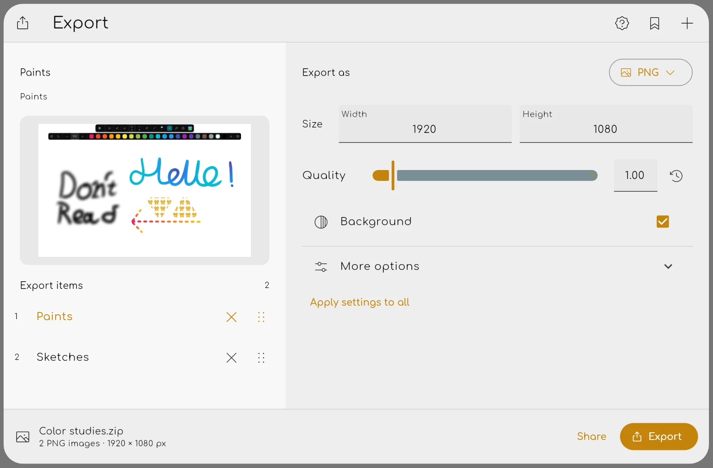

Butterfly 2.6.3-rc.1 is out!

Ever wanted to export several pages without repeating the same steps? Or resize a drawing without ending up with lines that are too thick or too thin?

This release brings a completely redesigned export dialog, more file formats, improvements to the Select tool and experimental display calibration.

If you missed the previous changes, check out the [2.6.3-rc.0 announcement](/butterfly/2.6.3-rc.0).

Highlights:

* 📤 Completely redesigned export dialog
* 📐 Better resizing and selection
* 📏 Experimental display calibration
* 🔄 Improved canvas navigation and smaller fixes

## Completely redesigned export dialog

> [#1267](https://github.com/LinwoodDev/Butterfly/issues/1267)

The export system has received a major overhaul!

Instead of having separate dialogs for images, SVG and PDF, Butterfly now has a **unified export dialog** with an improved layout and more options.

You can now export multiple pages and areas at once, configure individual export entries and preview the result before exporting.

Several new image formats have also been added, including **JPG, WebP, TIFF, GIF and BMP**, alongside additional formats and the existing PNG, SVG and PDF support.

Whether you're exporting illustrations, sharing notes or preparing content for another application, the new dialog should make the process much more convenient.

## Better resizing and selection

> [#1342](https://github.com/LinwoodDev/Butterfly/pull/1342)
> [#1340](https://github.com/LinwoodDev/Butterfly/issues/1340)
> [#1346](https://github.com/LinwoodDev/Butterfly/pull/1346)

The Select tool has received several improvements.

**Proportional resizing can now scale stroke widths too**, so drawings keep their appearance when you resize them instead of changing only their dimensions.

Grid snapping has been fixed and movement can now be constrained to straight lines in proportional mode. Touch shortcuts and selection previews should also behave more reliably.

Thanks to [@decision-fatigue-is-real](https://github.com/decision-fatigue-is-real) for contributing the proportional resizing feature and the Select tool gesture fixes!

## Experimental display calibration

> [#1310](https://github.com/LinwoodDev/Butterfly/issues/1310)

What does 100% zoom actually mean when every screen has a different pixel density?

Butterfly now has an **experimental display calibration** feature, allowing camera zoom to account for your display's physical dimensions.

This brings Butterfly closer to showing drawings at their intended real-world size, which is particularly useful when working with measurements.

PDF imports and paper presets now also use **96 canvas units per inch**, while exported PDFs preserve their page sizes.

The calibration feature is still experimental, so feedback from different devices would be useful.

## Improved canvas navigation and smaller fixes

> [#1347](https://github.com/LinwoodDev/Butterfly/issues/1347)
> [#1343](https://github.com/LinwoodDev/Butterfly/issues/1343)
> [#1350](https://github.com/LinwoodDev/Butterfly/issues/1350)

Rotating the canvas could previously restrict scrolling so much that parts of your drawing became unreachable. This has now been fixed.

There are also two smaller usability improvements: shape settings are expanded by default so fill options are easier to find, and unfinished file renames no longer remain active after opening a note.

Thanks to everyone who contributed code, reported issues or suggested improvements for this release.

If you encounter any problems with this release candidate, please report them on [GitHub](https://github.com/LinwoodDev/Butterfly/issues).

## Full changelog

* Add unified batch export for images, SVG, and PDF ([#1267](https://github.com/LinwoodDev/Butterfly/issues/1267))
* Add proportional resizing with stroke-width scaling to the select tool ([#1342](https://github.com/LinwoodDev/Butterfly/pull/1342))
* Add experimental display calibration and calibrated zoom for camera controls ([#1310](https://github.com/LinwoodDev/Butterfly/issues/1310))
* Fix Select tool gestures with touch shortcuts and clear stale selection previews ([#1346](https://github.com/LinwoodDev/Butterfly/pull/1346))
* Fix selection grid snapping and constrain movement in proportional mode ([#1340](https://github.com/LinwoodDev/Butterfly/issues/1340))
* Fix scrolling limits making drawings unreachable when the canvas is rotated ([#1347](https://github.com/LinwoodDev/Butterfly/issues/1347))
* Expand shape settings by default to make fill options visible ([#1343](https://github.com/LinwoodDev/Butterfly/issues/1343))
* Use 96 canvas units per inch for PDF imports and paper presets while preserving PDF page sizes on export
* Fix unfinished file renames remaining active after opening a note ([#1350](https://github.com/LinwoodDev/Butterfly/issues/1350))