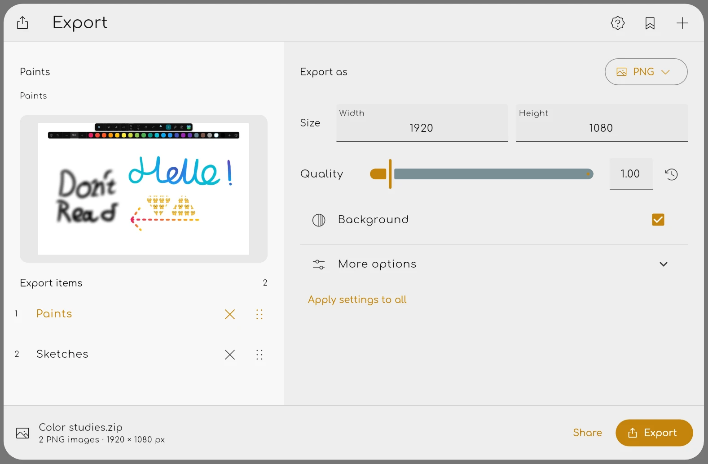

Butterfly 2.6.3 is available as a stable release! You can now drop files and browser images directly into your notes, export several pages or areas in one go, and resize drawings while keeping their stroke widths in proportion.

## Drag files in and export several pages at once

Drop a file or an image from your browser onto the canvas to import it. Import and export also use native file dialogs, and exports save with the extension for the format you chose. [#1314](https://github.com/LinwoodDev/Butterfly/issues/1314)

The new **Export** dialog brings images, SVG and PDF together. You can preview the output and configure each entry before exporting several pages or areas in one batch. JPG, WebP, TIFF, GIF and BMP are among the new image formats. [#1267](https://github.com/LinwoodDev/Butterfly/issues/1267)

## Resize drawings and adjust your view

The Select tool can now scale stroke widths along with the drawing during proportional resizing. Grid snapping and touch shortcuts also work more reliably, and proportional mode lets you constrain movement to a straight line. [#1342](https://github.com/LinwoodDev/Butterfly/pull/1342) · [#1340](https://github.com/LinwoodDev/Butterfly/issues/1340) · [#1346](https://github.com/LinwoodDev/Butterfly/pull/1346)

You can choose which sliders, text fields and buttons appear in the camera panel. Experimental display calibration lets camera zoom account for your screen’s physical size. PDF imports and paper presets now use 96 canvas units per inch, and exported PDFs preserve their page sizes. [#1223](https://github.com/LinwoodDev/Butterfly/issues/1223) · [#1310](https://github.com/LinwoodDev/Butterfly/issues/1310)

## Manage packs and follow sync progress

The redesigned pack dialogs use a compact grid and a responsive sidebar. You can add assets while setting up a new pack, and pack actions now respect the selected storage connection.

Connections can have custom icons, and Butterfly asks for confirmation before deleting one. The sync dialog now shows progress through nested folders and files, which makes it easier to follow a large WebDAV or Nextcloud sync. [#1330](https://github.com/LinwoodDev/Butterfly/issues/1330) · [#1337](https://github.com/LinwoodDev/Butterfly/issues/1337)

Switching pages also does less work, and a fix to scrolling limits keeps drawings reachable when the canvas is rotated. [#1336](https://github.com/LinwoodDev/Butterfly/issues/1336) · [#1347](https://github.com/LinwoodDev/Butterfly/issues/1347)

## Full changelog and downloads

The stable release includes the changes from both release candidates. See the [2.6.3-rc.0](/butterfly/2.6.3-rc.0) and [2.6.3-rc.1](/butterfly/2.6.3-rc.1) posts for the full lists, or download [Butterfly 2.6.3 on GitHub](https://github.com/LinwoodDev/Butterfly/releases/tag/v2.6.3).

Thanks to everyone who tested the release candidates, contributed fixes and reported issues! 💚
